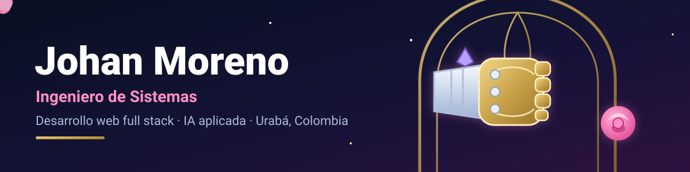

## 👋 Hola, soy Johan

Soy **Ingeniero de Sistemas** de la Universidad Católica Luis Amigó, de **Urabá, Colombia**. Construyo aplicaciones web que se usan de verdad (Next.js, TypeScript, Supabase) y también escribo redes neuronales desde cero, para entender qué pasa por dentro.

Hoy hago mis prácticas en soporte de sistemas en **COMTIC**, y lo siguiente en mi lista es **Angular y NestJS**. Mis proyectos los publico bajo el nombre artístico «La ficha».

Fuera del código soy fan de **Vi** (*League of Legends* y *Arcane*), y mi skin favorita es **Crystal Rose** 🌹: ella resuelve los problemas a golpes, yo prefiero resolverlos con pruebas. 👊

## 🧰 Con qué trabajo

  

**Además:** PWA, pruebas automáticas (Vitest), NumPy y PyTorch, soporte técnico de TI, osTicket, Scrum (lo usé en la universidad).

## 🚀 Mis proyectos

| Proyecto | Qué resuelve | Tecnologías | Enlaces |
| --- | --- | --- | --- |
| **Red neuronal desde cero** | Perceptrón multicapa escrito con **NumPy** (retropropagación, Adam e inicialización de He a mano, sin PyTorch ni TensorFlow): **98,1 %** en las 10 000 imágenes de prueba de MNIST. La demo lee números de varios dígitos en el navegador. | Python · NumPy · Next.js | [Demo](https://red-neuronal-desde-cero.vercel.app) · [Código](https://github.com/Johan-SnaiderMM/red-neuronal-desde-cero) |
| **Clasificador de hojas de banano** | Detecta si una hoja está sana o con Sigatoka, Cordana o Pestalotiopsis: transfer learning (MobileNetV2) exportado a ONNX para correr en el navegador. **98,5 %** en 134 fotos de prueba (entrenado con fotos de Bangladesh; aún sin validar con hojas de Urabá). | Python · PyTorch · ONNX · Next.js | [Demo](https://clasificador-hojas-banano.vercel.app) · [Código](https://github.com/Johan-SnaiderMM/clasificador-hojas-banano) |
| **Comanda** | Restaurantes pequeños: pedidos por mesa, para llevar y domicilio, fiado, gastos y cierre del día, y funciona sin conexión. La versión real está en uso en un negocio. | Next.js · Supabase | [Demo](https://comandacomi.vercel.app) · [Código](https://github.com/Johan-SnaiderMM/comandacomi) |
| **Polo Air Cool** | Taller de aire acondicionado automotriz, **en uso real**: órdenes con bitácora fotográfica, inventario, caja menor, garantías y portal del cliente. | Next.js · Supabase | [Sitio](https://polo-air-cool.vercel.app) · [Código](https://github.com/Johan-SnaiderMM/Air-Polo-Cool) |
| **Barberías** | Agenda del personal, reservas por enlace o QR y las cuentas del día: efectivo, Nequi, comisiones y cierre. | Next.js · Supabase | [Demo](https://barberias-demo-lyart.vercel.app) · [Código](https://github.com/Johan-SnaiderMM/barberias) |
| **Servitecas** | El cliente del taller ve el avance de su vehículo y autoriza los trabajos adicionales desde su celular. | Next.js · Supabase | [Demo](https://servitecas.vercel.app) · [Código](https://github.com/Johan-SnaiderMM/servitecas) |
| **Orígenes** | Memoria histórica de Urabá con realidad aumentada, escenas 360° y una avatar con IA. | React · Express · Three.js | [Web](https://www.aruma-origenes.com/login) · [Código](https://github.com/Johan-SnaiderMM/origenes) |
| **Consultorio psicológico** | Pacientes, lista de espera y documentos clínicos en PDF. | Node.js · PostgreSQL | [Código](https://github.com/Johan-SnaiderMM/Consultorio_Psicologia) |
| **Reporte ambiental** | Prototipo para reportar afectaciones ambientales con foto y ubicación, y gestionarlas en un mapa. | Vite · Leaflet · Supabase | [Código](https://github.com/Johan-SnaiderMM/Proyecto-Corpouraba) |
| **FlyRank ML** | Internado de ML: ranking y visibilidad en Google Search. | Python | [Código](https://github.com/Johan-SnaiderMM/flyrank-ml-internship) |
| **Pizza Party Pixel** | Una invitación interactiva en pixel art, hecha por diversión. | HTML · CSS · JavaScript | [Web](https://pizza-party-pixel.vercel.app) · [Código](https://github.com/Johan-SnaiderMM/pizza-party-pixel) |

> Los números son los medidos: 98,1 % es con un dígito aislado de MNIST; la lectura de números completos se midió con secuencias **sintéticas** (86,5 % de números completos bien) y su detalle está en el README del proyecto. Las demos usan datos inventados.

## 🛠️ Cómo trabajo

- **Mobile-first de verdad:** botones de 48 px, texto de 16 px, acciones abajo y sin depender de `hover`.
- **Cada negocio ve solo lo suyo:** el aislamiento vive en Postgres con RLS y lo verifican pruebas automáticas.
- **Pruebas sobre la lógica y la base de datos**, no solo sobre la interfaz.
- **Las demos usan datos inventados.**

## 📫 Contacto

  
  

Busco mi primer empleo como desarrollador junior (web full stack). Abierto a vacantes remotas o presenciales en Colombia.
